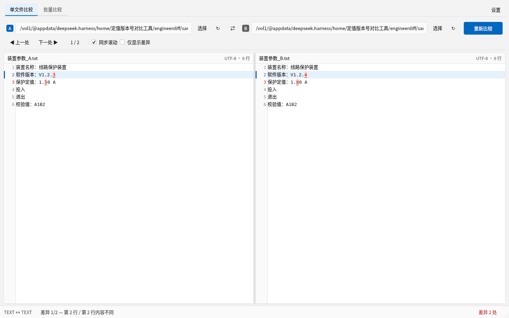
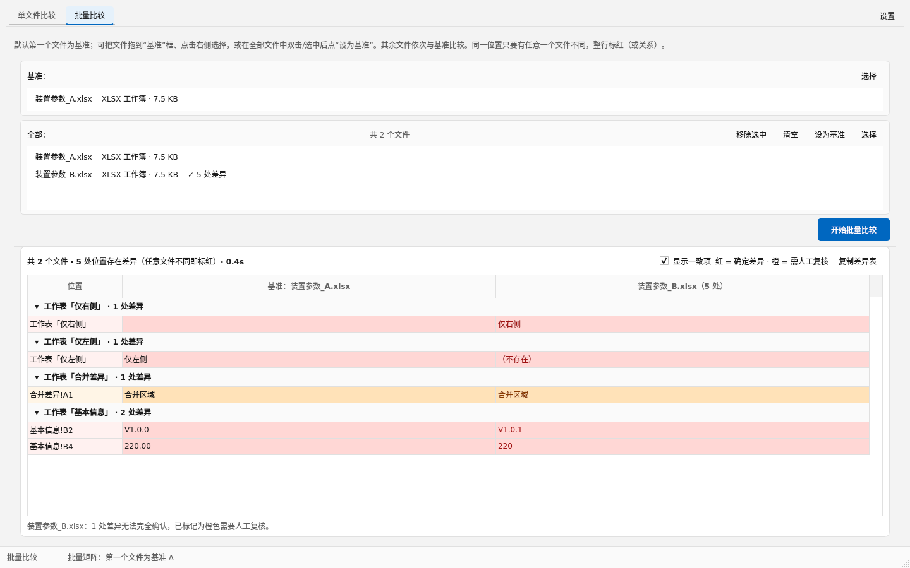
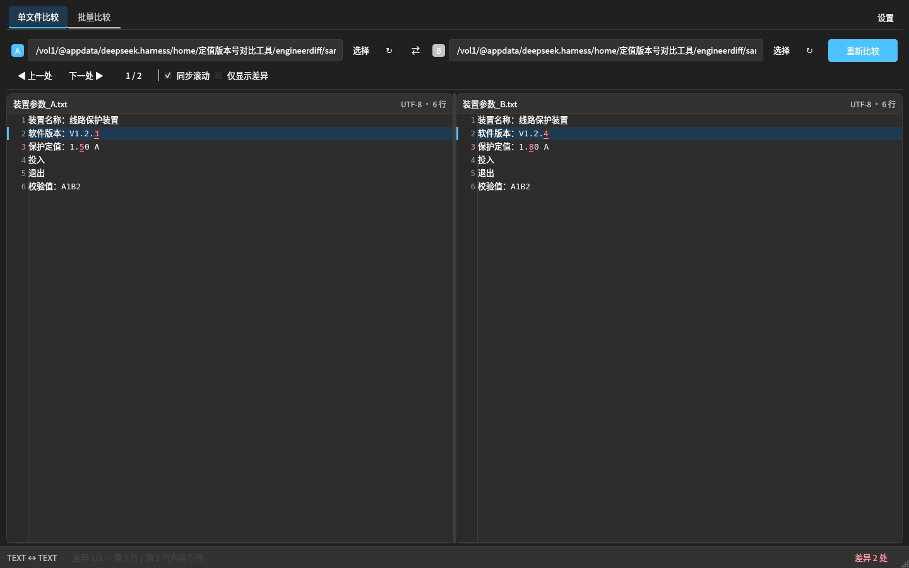
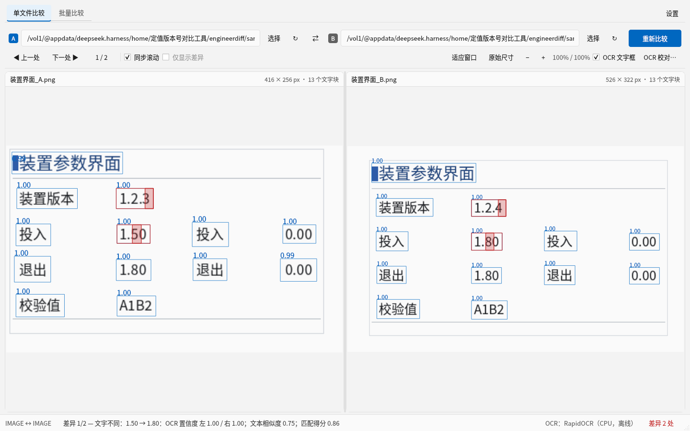

# EngineerDiff

**Windows 本地多格式文件差异比较工具**

EngineerDiff 用于核对装置软件版本、保护定值表、配置文件、Excel 工作簿和装置界面截图。
差异**直接标在原始内容上**：文本标到字符，Excel 标到单元格与 Sheet，截图标到原文字位置。

所有比较完全在本机完成；OCR 模型随安装包内置，**不联网、不上传文件、无需安装 Python / Office**。



## 核心能力

- **TXT / CSV**：编码自动识别，行级对齐 + 行内字符级差异，CSV 支持引号、逗号和跨行字段；
- **XLS / XLSX**：按 Sheet 名称配对，严格坐标比较；公式/缓存值策略可选；合并单元格、
  缺失 Sheet 与标签差异都有明确标记；
- **PNG / JPG / JPEG / BMP**：内置 RapidOCR + ONNX Runtime，跨尺寸/位置/缩放匹配文字，
  在原截图位置叠加红/橙差异框；
- **批量比较**：一个基准 + 多个候选，生成“任意文件不同即标红”的差异矩阵；
  基准可拖入或手动选择，Excel 按 Sheet 分组折叠，图片支持原图对照；
- **Fluent 2 界面**：单文件 / 批量顶部导航、浅色/深色/跟随系统、原生标题栏；
- **快捷操作**：拖入文件自动加载并比较、图片滚轮缩放、Ctrl+V 粘贴截图、F7/F8 差异导航；
- **OCR 校对**：查看文字框与置信度、修改识别文本、人工建立左右对应后重新比较；
- 纯离线，无账号、无云服务、无文件上传。

## 界面

| 单文件比较 | 批量比较 |
|---|---|
|  |  |

| 深色主题 | 图片 OCR |
|---|---|
|  |  |

## 下载与使用

从 [GitHub Releases](https://github.com/youyoudezhuzhu/EngineerDiff/releases/latest) 下载：

- `EngineerDiff-1.2.4-Setup-x64.exe`：Windows 10/11 x64 安装包；
- `EngineerDiff-1.2.4-portable-win64.zip`：便携版，解压后保持 `_internal` 目录完整。

使用步骤：

1. 选择或拖入左右两个文件；拖入后自动开始比较；
2. 用“上一处/下一处”或 F7/F8 查看差异；图片支持滚轮缩放和拖动；
3. 切换到“批量比较”，拖入基准与多个候选文件，一次查看全部差异。

详细说明：[用户手册](docs/user-guide.md)；限制：[已知限制](docs/known-limitations.md)。

## 系统要求

- Windows 10 / 11 x64，4 GB 内存以上；
- 默认按当前用户安装，无需管理员权限；
- 无需 Office、Python、VC++ 运行库或联网（VC++ release DLL 随包）。

## 技术实现

- 文本：`difflib` 行/字符级对齐，编码识别；
- 表格：openpyxl / xlrd 读取，严格坐标 + Sheet 名称配对，自绘虚拟化表格；
- OCR：RapidOCR + ONNX Runtime（CPU），小图自适应检测、识别批大小 16、缓存与后台预识别；
- 图片匹配：ORB / 文字锚点估计几何变换，结合文本相似度与邻域上下文；
- 打包：PySide6 + PyInstaller onedir + Inno Setup，GitHub Actions 构建 Windows 安装包。

更多细节见 [架构说明](docs/architecture.md) 与 [OCR 性能报告](docs/ocr-performance.md)。

## 开发与构建

```bash
python -m venv .venv
.venv/bin/pip install -r requirements-dev.txt
.venv/bin/pip install -e . --no-deps

QT_QPA_PLATFORM=offscreen .venv/bin/python -m pytest -q
.venv/bin/python -m engineerdiff --self-test
```

Windows 安装包构建：

```powershell
powershell -ExecutionPolicy Bypass -File scripts\build_windows.ps1
```

输出位于 `release\EngineerDiff-<version>-Setup-x64.exe` 与 `release\EngineerDiff-<version>-portable-win64.zip`。

## 文档与许可证

- [用户手册](docs/user-guide.md)
- [已知限制](docs/known-limitations.md)
- [Windows Defender / SmartScreen](docs/windows-defender.md)
- [代码签名 / 智能应用控制](docs/code-signing.md)
- [第三方许可证](docs/third-party-licenses.md)

项目代码采用 [MIT License](LICENSE)。Qt/PySide6、RapidOCR、ONNX Runtime、OpenCV、
openpyxl、xlrd、Pillow 等第三方组件遵循各自许可证。
