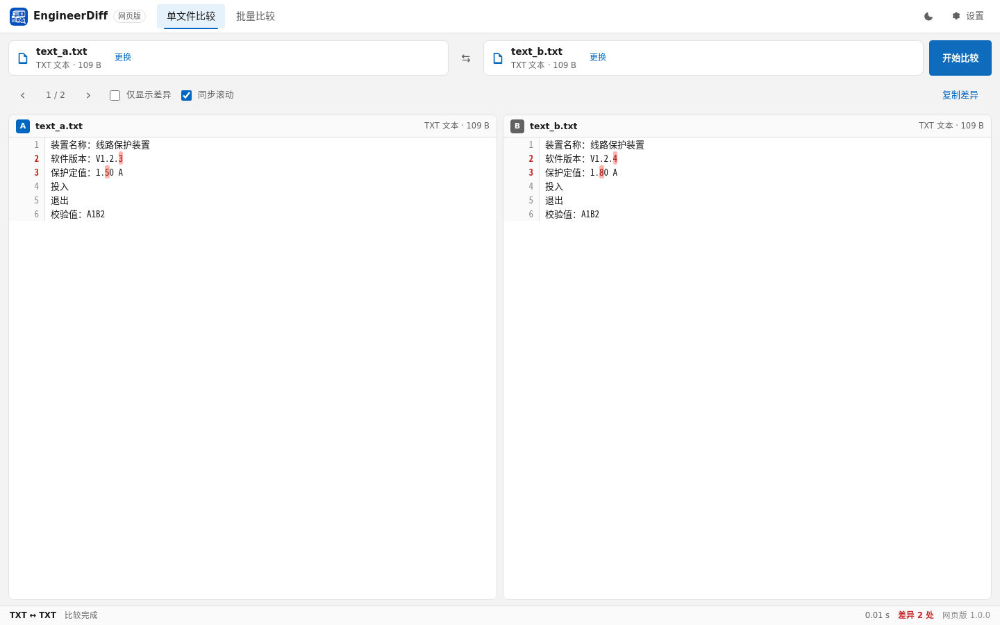

# EngineerDiff 网页版

EngineerDiff 网页版是桌面版的**免安装浏览器版本**，用于在没有 Windows 机器、或临时需要在
手机/平板上查看差异的场景。所有文件只在浏览器本地解析和比较，**不会上传到任何服务器**。

在线地址：<https://youyoudezhuzhu.github.io/EngineerDiff/>



## 支持范围

| 能力 | 网页版 | 说明 |
|---|---|---|
| TXT 文本比较 | ✅ | 与桌面版同一套行/字符对齐算法，编码自动识别 |
| CSV 比较 | ✅ | 文本视图 + 表格视图切换，引号/跨行字段 |
| XLS / XLSX / XLSM | ✅ | 按 Sheet 名称配对、公式/缓存值、数值容差、合并单元格 |
| 批量比较 | ✅ | 基准 + 多候选，“任意文件不同即标红”，Excel 按 Sheet 分组 |
| 工作表标签滚动 / 拖动 | ✅ | 标签过多时可用滚轮、拖动或左右箭头 |
| 表格列宽 / 行高调整 | ✅ | 拖动列标或行号边界 |
| 深色 / 浅色 / 跟随系统 | ✅ | 设置保存在浏览器本地 |
| 差异导航 / 仅显示差异 / 同步滚动 / 同步 Sheet | ✅ | 桌面版同款操作 |
| 手机查看与选择文件 | ✅ | 响应式布局，A/B 单栏切换 |
| 离线打开（PWA） | ✅ | 首次加载后可离线使用 |
| 图片 / 截图 OCR | ❌ | 需要本地 OCR 模型与原生推理，请使用桌面版 |
| 安装包 / 系统集成 | ❌ | 网页版无需安装 |

> 图片、截图 OCR 与安装包能力只在桌面版提供，原因是 OCR 需要 ONNX Runtime 与本地模型，
> 浏览器内运行会慢 3–8 倍，且需要 GitHub Pages 无法配置的 COOP/COEP 响应头。

## 使用步骤

### 单文件比较

1. 打开网页，点击（手机上轻点）左右两个文件框，或把文件拖入框内；
2. 两侧文件都就绪后自动开始比较；
3. 用工具栏的“上一处 / 下一处”（键盘 F7 / F8）查看差异；
4. TXT 直接显示文本双栏；CSV 可点“文本 / 表格”切换；Excel 默认表格视图，
   底部标签显示各 Sheet 的差异状态（红色 = 有差异，橙色 = 需人工复核）；
5. 手机上用“A 基准 / B 待比较”切换左右栏，点“下一处”会自动跳到有差异的一侧。

### 批量比较

1. 切到顶部“批量比较”；
2. 把同类型文件拖入“全部”框（或点击“选择”多选），第一个文件默认为基准；
3. 可把某个文件拖到“基准”框、双击列表项，或选中后点“设为基准”；
4. 点“开始批量比较”，结果矩阵中任意候选与基准不同即标红，橙色表示需人工复核；
5. Excel 结果按 Sheet 分组，可折叠；支持复制/下载 TSV 差异表。

### 比较设置

右上角“设置”可调整：

- 忽略换行符 / 行首尾空格 / 全部空白 / 大小写；
- 公式比较方式（公式表达式 / 缓存值）与数值容差；
- 智能行对齐（实验性）；
- 默认同步滚动、同步 Sheet；
- 主题。

设置保存在浏览器 `localStorage`，下次打开仍然有效。

## 文件与隐私

- 支持扩展名：`.txt`、`.csv`、`.xls`、`.xlsx`、`.xlsm`；
- 文件通过浏览器 `File` API 读取，解析、比较全部在本地完成；
- 页面不加载第三方统计、不上传文件、不需要登录；
- 首次访问后 Service Worker 会缓存应用本身（不含任何用户数据），断网也能打开。

## 已知限制

- **不支持图片与 OCR**：请使用桌面版；
- **超大文件**：浏览器内存有限，建议单个文件不超过约 50 MB / 5 万行；
  Excel 单元格上限与桌面版一致（5 万行、2 千列、50 万单元格），超出会截断并提示；
- **XLS 公式**：XLS 格式不保存公式表达式，只能按缓存值比较（与桌面版一致，会显示警告）；
- **单元格样式**：网页版只读取字体颜色/填充等基础信息用于显示，不比较样式；
- **行高列宽**：网页版拖动调整只影响当前查看，不写回文件（与桌面版一致）；
- **浏览器兼容**：建议 Chrome / Edge 100+、Firefox 100+、Safari 16+；
  过旧浏览器可能不支持 `TextDecoder` 的部分编码或 ES Module；
- **访问速度**：GitHub Pages 在中国大陆的访问可能不稳定，可自行部署到内网静态服务器。

## 本地运行与测试

网页版是**无构建步骤**的静态站点，直接用任意静态服务器打开 `web/` 即可：

```bash
python -m http.server 8765 --directory web
# 打开 http://localhost:8765/
```

运行一致性测试（需要 Node.js 20+ 与 python3）：

```bash
# 文本、表格、批量比较结果与桌面版 Python 引擎逐项比对
node --test web/tests/*.test.mjs
```

测试依赖：`web/tests/reference/*.py` 会调用 `src/engineerdiff` 的桌面引擎，
表格用例还需要 `openpyxl` 与 `xlrd`：

```bash
python3 -m pip install openpyxl xlrd
```

## 目录结构

```
web/
├── index.html              # 单页应用入口
├── css/app.css             # Fluent 2 风格、浅色/深色、响应式
├── js/
│   ├── app.js              # 页面状态、单文件比较、设置、主题
│   ├── batchview.js        # 批量比较界面与差异矩阵
│   ├── textview.js         # 文本双栏（窗口化渲染）
│   ├── gridview.js         # Canvas 表格（表头、合并单元格、Sheet 标签）
│   ├── seqmatcher.js       # difflib.SequenceMatcher 的 JS 移植
│   ├── textdiff.js         # 文本比较引擎（编码识别、行/字符对齐）
│   ├── workbook.js         # XLS/XLSX（SheetJS）与 CSV 读取
│   ├── sheetcompare.js     # 表格比较引擎（严格坐标、公式、容差）
│   ├── batch.js            # 批量比较与“或语义”合并
│   └── dom.js              # DOM/格式化/图标工具
├── vendor/xlsx.full.min.js # SheetJS 0.20.3（Apache-2.0，原样内置）
├── assets/                 # PWA 图标
├── manifest.webmanifest
├── sw.js                   # Service Worker（离线缓存）
└── tests/                  # node:test + Python 参考结果
```

## 实现说明

网页版不是“重新实现一套近似算法”，而是把桌面版引擎逐行移植，并用桌面版 Python 实现生成
期望结果做逐字段比对：

- `textdiff.js` 对应 `src/engineerdiff/textdiff/engine.py`：编码探测顺序、`SequenceMatcher`
  autojunk 规则、替换块 DP 对齐（相似度 − 0.30 奖励）、字符 span 归一化映射、换行符差异；
- `sheetcompare.js` 对应 `src/engineerdiff/spreadsheet/engine.py`：Sheet 名称配对、严格坐标、
  公式/缓存值模式、数值容差、合并单元格锚点、仅单侧 Sheet、智能行对齐；
- `batch.js` 对应 `src/engineerdiff/batch.py`：差异键、位置标签、基准值填充、“或语义”合并、
  排序与 Sheet 分组；
- 测试 `web/tests/{textdiff,sheet,batch}.test.mjs` 会启动 `python3` 调用桌面版代码，
  要求两边的差异列表、标题、详情、字符区间完全一致。

为了在浏览器中保持流畅，网页版额外做了：

- 文本视图只渲染视口内行（10 万行也只有几十个 DOM 节点）；
- 表格使用 Canvas 自绘 + 原生滚动条，虚拟化绘制可见单元格；
- 大文件比较在文件之间让出事件循环，进度条持续更新。

## 部署

仓库通过 GitHub Actions 自动部署：`.github/workflows/pages.yml` 会先运行一致性测试，
再把 `web/` 作为静态站点发布到 GitHub Pages。也可以在任意静态服务器上直接托管 `web/` 目录。

修改前端资源后，请同步修改 `web/sw.js` 中的 `CACHE` 版本号（例如 `engineerdiff-web-v2`），
否则已访问过的用户可能继续使用旧缓存。
